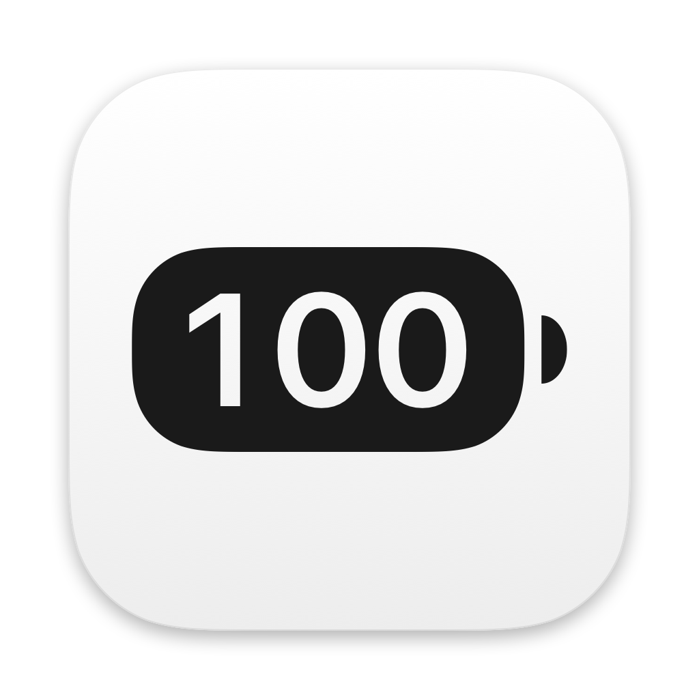
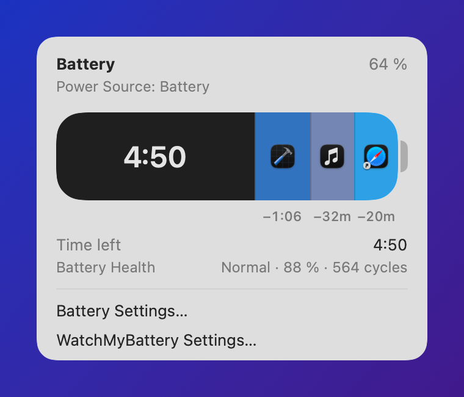

<p align="center">
  
</p>

<h1 align="center">WatchMyBattery</h1>

<p align="center">
  <b>The battery icon your menu bar should have had.</b><br>
  See which apps are draining your Mac, and how much time you'd get back by quitting them. Then drag one out to quit it.
</p>

<p align="center">
  <a href="https://github.com/Pallepadehat/WatchMyBattery/actions/workflows/ci.yml"></a>
  
  
  <a href="LICENSE"></a>
</p>

<p align="center">
  <picture>
    <source media="(prefers-color-scheme: dark)" srcset="docs/panel-dark.png">
    
  </picture>
</p>

## Features

**A better battery icon**
- Drains as your battery drains, just like the built-in one, and sits where it does.
- The percentage inside the battery, beside it, or not at all.
- A bolt while charging, a plug while plugged in but not charging.
- Red when low and green when charging, or monochrome so it blends in with the rest of the menu bar.

**A Battery panel that shows what's draining it**
- Click the icon for a panel that looks like the system's Battery menu: the percentage, the power source, and a big capsule-shaped battery.
- The white fill is the charge you have left. The **coloured slices at the end of it are the apps using the most energy right now**, each with its icon and an estimate of the battery time it's costing you, like **−48m**.
- The centre of the battery shows the time remaining, or the percentage if you prefer.
- A switch for Low Power Mode, and a nudge to turn it on when the battery runs low.
- Open it from any app with a keyboard shortcut of your choice.

**Drag an app out to quit it**
- Pull an app's slice out of the panel and let go. The app quits with a *poof*, like removing an icon from the Dock.
- While you hover over or drag a slice, the **Time left** row previews what you'd gain: **4:50 +1:10**.
- Optionally asks before quitting, so a stray drag never costs you unsaved work. If an app doesn't quit (it's asking about unsaved changes, say), the panel tells you and can bring it forward.
- Works with the keyboard and VoiceOver too: Tab between slices, Delete to quit one.
- Hide apps you never want to quit by accident, like Music or your VPN.

**The last 24 hours, and the last 10 days**
- A chart of the battery level over the last day, with the time plugged in marked, like iPhone's Battery settings.
- Switch to **10 Days** for how much battery each day used, an average day, and the apps that used the most over them.
- How long the Mac has been on battery since it was unplugged, and the average drain per hour.
- The apps that used the most battery, and how much battery time each one cost.
- An optional notification when an app keeps using a lot of power for a while, with a button that quits it.

**Insights, at the right moment**
- 📅 **Charge before your meeting**: *"Charge before your 14:00 meeting. The battery should last until about 13:30."* From the Calendar app, opt in, with a warning time you choose (15 minutes to 2 hours ahead).
- 📈 **More than usual**: *"About 30% more than at this time on most days, mostly because of Xcode."* Once it knows what's usual for your Mac, after about a week.
- ✨ **A new app using a lot**: one that hadn't used much battery in the last two weeks, and is now among the hungriest.
- In the panel, and as notifications if you want them.

**Battery health, and a heads-up when it runs low**
- Condition, maximum capacity and cycle count, quietly, under the time.
- An optional notification at the levels you choose, naming the hungriest app, with a button that quits it.
- A soft glow flows into the battery while it charges, in the menu bar and the panel. Turn it off if you prefer a still icon.
- Shortcuts actions for the battery level, the time left and the app using the most energy, also in Spotlight.
- In English and Danish.

**Light on your battery** (it would be a bit silly otherwise)
- No polling: battery changes arrive as notifications from macOS.
- Apps are sampled every two seconds while the panel is open. For the history, every five minutes on battery, and never on the adapter.
- The menu bar icon is redrawn only when something you can see changes. The charging animation is a short sweep every few seconds, only while charging, and it stops while the displays sleep.

## Languages

English and Danish. WatchMyBattery follows your Mac's language; to pick one just for it, use **Settings › General › Language**. Translations are welcome: see [CONTRIBUTING](CONTRIBUTING.md#translations).

## Install

You need a Mac with a battery on **macOS 14 or later**. Paste this into Terminal:

```sh
curl -fsSL https://raw.githubusercontent.com/Pallepadehat/WatchMyBattery/main/install.sh | bash
```

It downloads the latest release, puts WatchMyBattery in your Applications folder (replacing an older copy), and opens it. After that, the app keeps itself up to date.

<details>
<summary><b>Or use the .dmg</b></summary>
<br>

Download **WatchMyBattery.dmg** from the [latest release](https://github.com/Pallepadehat/WatchMyBattery/releases/latest), open it and drag WatchMyBattery into Applications.

If a release isn't notarized by Apple (its notes say so), macOS says it can't check WatchMyBattery for malware the first time you open it. Click **Done**, then open **System Settings › Privacy & Security**, scroll down and click **Open Anyway**. Or run:

```sh
xattr -dr com.apple.quarantine /Applications/WatchMyBattery.app
```

The install script does this for you. It's [short and readable](install.sh), if you'd like to check it first.

</details>

<details>
<summary><b>Or build it from source</b></summary>
<br>

See [Building](#building) below.

</details>

<details>
<summary><b>Uninstall</b></summary>
<br>

Quit WatchMyBattery from its panel, turn off **Launch at login** first if you'd enabled it, then:

```sh
rm -rf /Applications/WatchMyBattery.app
defaults delete com.pallepadehat.WatchMyBattery
rm -rf ~/Library/Caches/com.pallepadehat.WatchMyBattery
```

Don't forget to turn Apple's battery icon back on (see below).

</details>

## Replace the built-in battery icon

WatchMyBattery is meant to take the place of Apple's battery icon, so you'll want to hide that one:

**System Settings › Control Center › Battery**, and turn off **Show in Menu Bar**.

**Settings › General › Hide the Built-in Battery** opens that page for you. To get Apple's icon back, turn the switch on again.

## How it works

The numbers in the panel are **estimates**. They're good at answering "what's eating my battery, roughly how much, and is it worth quitting?", but they're not a measurement of the future. Here's exactly where they come from.

**Battery level, charging state and time remaining** come from IOPowerSources, the same source macOS uses for its own battery menu, so the percentage and the time left match what the system shows.

**Battery health** (condition, maximum capacity and cycle count) comes from `system_profiler SPPowerDataType`, which is where System Settings' figures come from too. It runs at most every few hours, in the background, when the panel opens. If it isn't available, the cycle count and an approximate capacity come from the battery controller instead.

**How much power each app is using.** The kernel keeps a running energy counter for every process (`ri_energy_nj` from `proc_pid_rusage`, `RUSAGE_INFO_V6`, in nanojoules). While the panel is open, WatchMyBattery reads it for every process at regular intervals and divides the change by the time between readings, which gives each process's average power over that interval. Processes are grouped by their **responsible app**, so a browser's helper and renderer processes count toward the browser, the same grouping Activity Monitor uses.

**History.** On battery, WatchMyBattery reads the same counters every five minutes. They keep counting in between, so a rare reading still sees all the energy each app used (except apps that opened and quit between two readings). Each app's energy over the last 24 hours, divided by the Mac's average power draw, is the battery time it cost. The battery level is recorded whenever macOS reports a change. Every hour is also summed up (time on battery, battery used, the Mac's power draw and each app's energy), and those summaries are kept for two weeks, for the ten-day chart and the insights. It's all kept with SwiftData in `~/Library/Application Support/WatchMyBattery/History.store`, which only writes what changed: a row for each level change or sample, and the hour it touched.

**Insights.** *More than usual* compares the Mac's average power draw over the last 45 minutes with the same time of day (give or take an hour) on earlier days, and only once at least five days have readings then. It speaks up at 20% and 1 W more, rounds to the nearest 10%, and names an app only if it accounts for at least half of the difference. *A new app* needs a week of history: an app first seen in the last three days that's among the three hungriest of the last 24 hours, with at least a fifth of their energy. *Charge before your meeting* adds macOS's time left to now, and warns when that's before the end of a meeting starting within the warning time you chose (or already under way). It skips all-day events, ones you've declined and ones marked as free.

**Runaway apps.** An app counts as running away when it averages 4 W or more over 15 minutes on battery. You hear about each one once, until it calms down or you plug in, and never about the app you're using.

**How much power the whole Mac is using.** The battery's own controller reports its voltage and current (the `AppleSmartBattery` entry in the IORegistry). Voltage × current is the power flowing out of the battery right now, for everything: apps, the display, the radios, the system itself.

**How much time an app costs you.** If the Mac draws power *P*<sub>system</sub> and the time left is *T*, the battery holds about *T* × *P*<sub>system</sub> of energy. Without an app drawing *P*<sub>app</sub>, the same energy would last *T* × *P*<sub>system</sub> / (*P*<sub>system</sub> − *P*<sub>app</sub>). The difference is the time you'd gain by quitting it:

> time gained ≈ *T* × *P*<sub>app</sub> / (*P*<sub>system</sub> − *P*<sub>app</sub>)

That's the **−48m** on a slice, and the **+1:10** you see when you hover over or drag one.

**Why it's an estimate, honestly:**
- The kernel's energy counters are themselves modelled from CPU and GPU activity, not read off a power meter per app. Energy for the display, Wi-Fi and other hardware mostly isn't charged to any app.
- Power use changes from second to second. The estimate assumes the next few hours look like the last few seconds, which they rarely do exactly.
- Quitting an app can change what other processes do (a sync daemon may calm down, or another app may wake up).
- macOS's own time remaining is an estimate too, and it isn't available while the Mac is charging or still working it out.

So treat **−48m** as "this app is a big reason your battery is draining", not as a promise of 48 more minutes.

## Privacy & performance

- **Nothing leaves your Mac.** No analytics, no accounts, no telemetry. The only network request is Sparkle's update check against this repository's GitHub releases, and you can turn automatic updates off in Settings.
- WatchMyBattery reads process **energy counters and names**, never what those apps contain or do.
- It isn't sandboxed, because the sandbox doesn't allow reading other processes' energy use or quitting other apps. It only ever quits an app you ask it to: one you drag out of the panel, delete with the keyboard, or quit from a low battery notification.
- **Calendar access is opt in**, asked for only when you turn on *Charge Before Meetings*. It reads when events start and end, whether they're all day or marked as free, and whether you declined them: never titles, places, notes or who's invited. Nothing from your calendar is stored or sent anywhere.
- The low battery, runaway app and insight notifications are off until you turn them on. When the low battery one goes off, apps are measured for two seconds to find the hungriest one.
- Battery changes arrive as IOPowerSources notifications, so there's no polling timer, and the menu bar icon is redrawn **only when something visible changes**.
- Processes are sampled every two seconds while the panel is open, and otherwise **only on battery, every five minutes**, for the history. A sample is about a millisecond of CPU time (on a Mac running around 900 processes), so roughly 12 ms an hour. macOS gets a minute's leeway on each one to fold it into other wake-ups. Turn the history off in **Settings › Panel** and the app is idle with the panel closed, as before. The history never leaves your Mac. The insights are worked out from those same samples, with no sampling of their own; the meeting warning is checked when the battery or your calendar changes, and once more when a meeting comes close, never on a timer.

## Settings

Settings is laid out like System Settings, with a pane for each part:

| Pane | Settings |
| --- | --- |
| General | Open at login, language (System, English or Dansk), shortcuts to hide the built-in battery and to System Settings › Battery |
| Menu Bar | Percentage hidden, inside the battery or beside it; coloured states (red when low, green when charging) or monochrome; the charging animation |
| Panel | Time remaining or percentage in the centre of the battery, how many apps get a slice, asking before quitting, hidden apps that never get a slice, the battery history (on, off, or clear it), and insights in the panel |
| Notifications | A low battery notification and the levels it's sent at, a notification for apps using a lot of energy, and insights: charge before meetings (and how far ahead), more than usual, and new apps using a lot |
| Updates | Check now (the answer shows right in the row), and check for and install updates automatically |
| About | The version, and links to the source code, the changelog and the bug report form |

## Updates

WatchMyBattery updates itself with [Sparkle](https://sparkle-project.org). Each [GitHub release](https://github.com/Pallepadehat/WatchMyBattery/releases) carries an `appcast.xml` signed with the project's EdDSA key, and the app only installs updates that carry a valid signature from that key. Turn off **Settings › Updates › Check for Updates Automatically** if you'd rather update by hand, for example by running the install command again.

## Building

You need **Xcode 27 or later** (the project uses Xcode 27's project format). The app itself runs on macOS 14 and later.

```sh
git clone https://github.com/Pallepadehat/WatchMyBattery.git
cd WatchMyBattery
open WatchMyBattery.xcodeproj    # then press ⌘R
```

Or build from the command line with `./scripts/build.sh`, which leaves the app at `build/WatchMyBattery.app`.

Builds work without an Apple developer team (they're signed ad hoc). To sign with yours, copy `Config/Local.xcconfig.example` to `Config/Local.xcconfig` and add your team ID. That file is git-ignored.

The estimation logic lives in a Swift package with its own tests:

```sh
cd Packages/BatteryKit
swift test
```

| Folder | What's inside |
| --- | --- |
| [`Packages/BatteryKit`](Packages/BatteryKit) | The testable logic: battery state and health, per-app energy, the time estimates, and when to send a low battery notification. |
| [`WatchMyBattery`](WatchMyBattery) | The app: the menu bar icon and its charging animation, the panel, notifications, settings, updates, and the strings and their translations (`Localizable.xcstrings`). |
| [`Config`](Config) | Signing settings and `Info.plist` (including Sparkle's feed URL and public key). |
| [`scripts`](scripts) | Building, packaging and releasing, plus `generate-icon.swift`, which writes the app icon (`WatchMyBattery/AppIcon.icon`, an Icon Composer icon) and logo, and `generate-social-preview.swift`, which draws the GitHub social preview. |
| [`install.sh`](install.sh) | The one-command installer. |

## Roadmap

What's coming next is in [ROADMAP.md](ROADMAP.md).

## Contributing

Contributions are very welcome: bug fixes, polish, better estimates, and ideas. Work lands on the `develop` branch through pull requests. Start with [CONTRIBUTING.md](CONTRIBUTING.md), and please follow the [code of conduct](CODE_OF_CONDUCT.md). Security issues go through [private reporting](SECURITY.md).

## License

[MIT](LICENSE) © 2026 Patrick Jakobsen

## Acknowledgements

- [Sparkle](https://sparkle-project.org), which keeps WatchMyBattery up to date.
- Apple's own Battery menu and Activity Monitor, for the look and for the idea of grouping processes by the app responsible for them.
