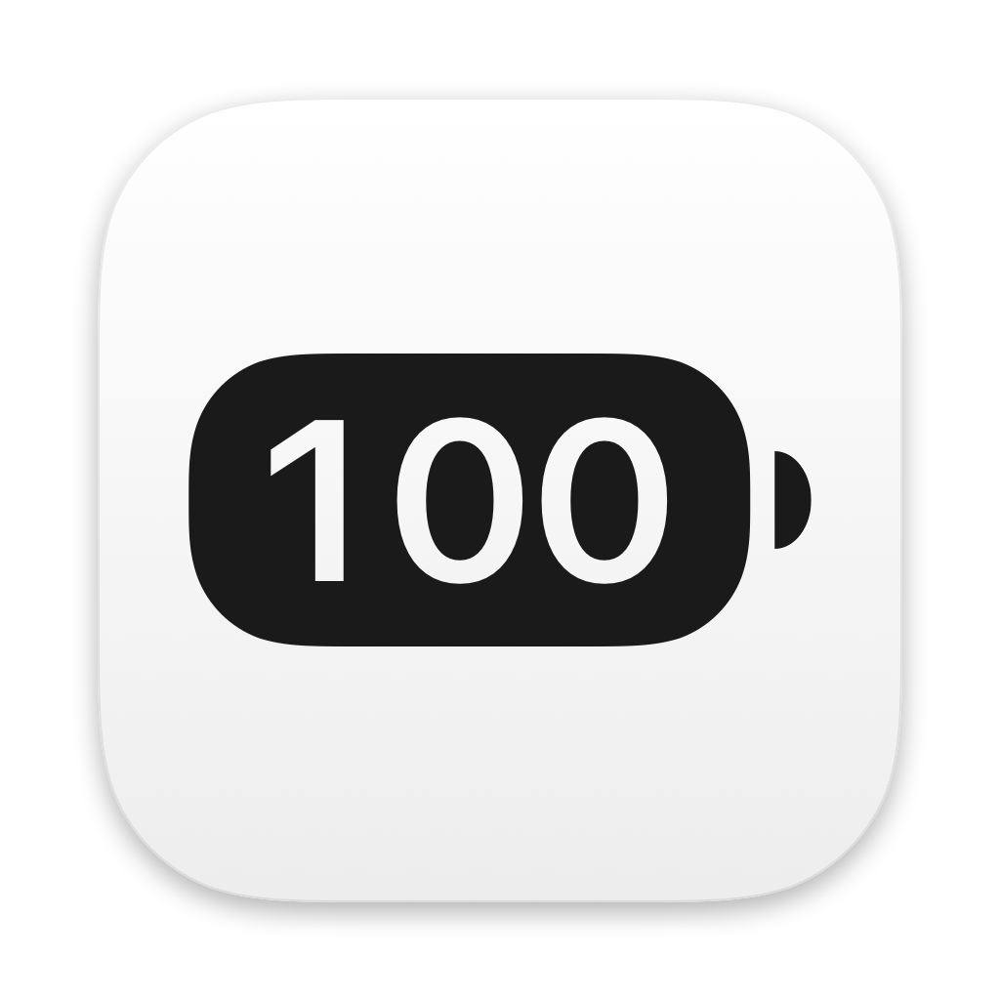
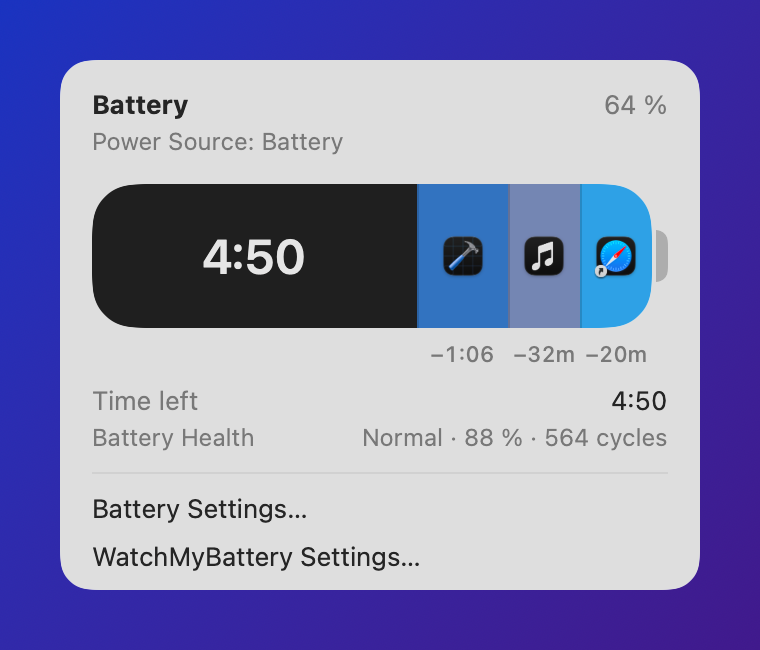
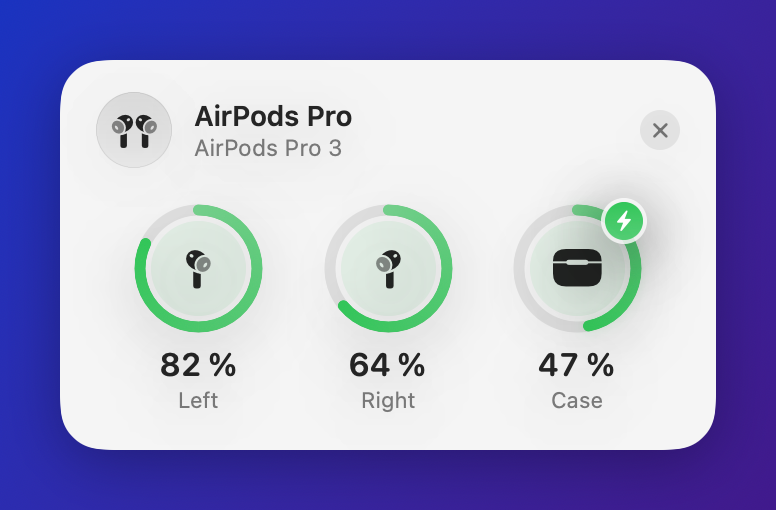

<p align="center">
  
</p>

<h1 align="center">WatchMyBattery</h1>

<p align="center">
  <b>The battery icon your menu bar should have had.</b><br>
  See which apps are draining your Mac, and how much time you'd get back by quitting them. Then drag one out to quit it.
</p>

<p align="center">
  <a href="https://github.com/Pallepadehat/WatchMyBattery/actions/workflows/ci.yml"></a>
  
  
  <a href="LICENSE"></a>
</p>

<p align="center">
  <picture>
    <source media="(prefers-color-scheme: dark)" srcset="docs/images/panel-dark.png">
    
  </picture>
</p>

## Features

**A welcome tour** that walks you through the menu bar, the animations, the panel and notifications, with a live preview of each choice.

**A better battery icon**
- Drains as your battery drains, just like the built-in one, and sits where it does.
- Three styles: the **battery**, a **ring** that fills as it charges, or **text only**.
- Beside it, the percentage, the **time left**, or the Mac's **power draw** in watts. Or nothing, with the percentage inside the battery if you like.
- A bolt while charging, a plug while plugged in but not charging.
- Red when low and green when charging, or monochrome so it blends in with the rest of the menu bar.

**A Battery panel that shows what's draining it**
- Click the icon for a panel that looks like the system's Battery menu: the percentage, the power source, and a big capsule-shaped battery.
- The white fill is the charge you have left. The **coloured slices at the end of it are the apps using the most energy right now**, each with its icon and an estimate of the battery time it's costing you, like **−48m**.
- The centre of the battery shows the time remaining, or the percentage if you prefer.
- A switch for Low Power Mode, and a nudge to turn it on when the battery runs low.
- Open it from any app with a keyboard shortcut of your choice.

**Drag an app out to quit it**
- Pull an app's slice out of the panel and let go. The app quits with a *poof*, like removing an icon from the Dock.
- While you hover over or drag a slice, the **Time left** row previews what you'd gain: **4:50 +1:10**.
- Optionally asks before quitting, so a stray drag never costs you unsaved work. If an app doesn't quit (it's asking about unsaved changes, say), the panel tells you and can bring it forward.
- Works with the keyboard and VoiceOver too: Tab between slices, Delete to quit one.
- Hide apps you never want to quit by accident, like Music or your VPN.

**The last 24 hours, the last 10 days, and the last year**
- A chart of the battery level over the last day, with the time plugged in marked, like iPhone's Battery settings.
- Switch to **10 Days** for how much battery each day used, an average day, and the apps that used the most over them. Click a day for that day's own apps.
- How long the Mac has been on battery since it was unplugged, and the average drain per hour.
- The apps that used the most battery, and how much battery time each one cost. Click one for its use hour by hour (or day by day), its share and when it's busiest.
- 📊 **Settings › History** goes back as far as the history is kept, up to a year: battery used each day (or week), every app ranked, and a page for each app with the battery time it cost, its average draw, the days it ran, when in the day it's busiest, and whether it's using more or less than before.
- 🌡️ **Settings › Battery Health** keeps the battery's vital signs, from the last 24 hours to a year: its temperature (and how long it ran warm), charge level, what the Mac drew and the charger gave, its voltage, and its maximum capacity and charge cycles day by day, so you can watch it wear. See temperature and power through the day, narrow everything to the time on battery or plugged in, and compare with the period before. Hover over a chart for its numbers, and export it all as CSV.
- An optional notification when an app keeps using a lot of power for a while, with a button that quits it.

**Where the battery's headed** 🔮
- **A forecast** in the panel: on battery, the last 24 hours' chart goes on past now with a dashed line to where the level is headed, and says when it should reach 20% and run out. It starts at the pace your Mac is going now and leans towards how the battery usually goes at those hours, from your own history, so a forecast at 9:00 knows your afternoons are busier.
- **Your week**: this week (or last) against the week before in Settings › History, with the time on battery, battery used and average draw, the three hungriest apps, the app that grew the most and the busiest day. And, if you like, a notification on Monday morning summing up the week before.

**Rules that look after the battery for you** 🪄
- *"When the battery drops to 20%, turn on Low Power Mode and quit Docker."* *"When the charger is connected, turn Low Power Mode off."* In **Settings › Rules**.
- When the battery drops to a level, charges to one, or the charger is connected or disconnected: turn Low Power Mode on or off, quit apps, change the charge limit, **run a shortcut** from the Shortcuts app, or just send a notification.
- Each runs once on the way down (or up), not again for a reading wobbling around its level, and never just because the app opened below it.

**Widgets and Control Center** 🧩
- A **Battery widget** for the desktop and Notification Center: the level and time left, the apps that used the most, a yellow badge while Low Power Mode is on, and in the large size the last day with the forecast. It keeps counting down between updates, along the forecast.
- A **Batteries widget** with your Mac, AirPods and Magic accessories, a ring each, like iPhone's.
- On macOS 26, **Low Power Mode** and **Battery** controls for Control Center and the menu bar.
- Click a widget for the panel. Widgets need a build signed with a developer team (every release is).

**Insights, at the right moment**
- 📅 **Charge before your meeting**: *"Charge before your 14:00 meeting. The battery should last until about 13:30."* From the Calendar app, opt in, with a warning time you choose (15 minutes to 2 hours ahead).
- 📈 **More than usual**: *"About 30% more than at this time on most days, mostly because of Xcode."* Once it knows what's usual for your Mac, after about a week.
- ✨ **A new app using a lot**: one that hadn't used much battery in the last two weeks, and is now among the hungriest.
- In the panel, and as notifications if you want them.

**Your AirPods and Magic accessories**

<p align="center">
  <picture>
    <source media="(prefers-color-scheme: dark)" srcset="docs/images/airpods-card-dark.png">
    
  </picture>
</p>

- 🎧 **The AirPods card.** Put your AirPods in and a glass card slides in below the menu bar, with a ring for each earbud and the case that fills up as it appears, like on iPhone. A bolt marks what's charging. It stays while the pointer is over it, and a click opens the panel. Choose where it appears and how long it stays, or turn it off.
- Every connected accessory with a battery in the panel: AirPods and Beats (each earbud and the case), the Magic Mouse, Keyboard and Trackpad, and game controllers. Even on a Mac without a battery of its own.
- Every Apple accessory is drawn as itself, with its own symbol (AirPods Pro, AirPods Max, Powerbeats Pro, Studio Buds…), and a renamed one shows its model under your name for it.
- An optional notification when one runs low, at a level of its own (20% to start with).
- 📱 **Your iPhone and iPad** too, over the cable or over Wi‑Fi once it's set up in Finder. When it drops off Wi‑Fi, its last reading stays, saying how old it is, with a button to read it again.

**Charging, your way**
- 🔋 **A charge limit**: hold the battery at 80% to 95% while plugged in, so it lasts longer. It's macOS's own (Apple silicon, macOS 26.4 or later), so it holds even when WatchMyBattery isn't running. Change it from the panel or Settings.
- **Charge to Full Once** for a long day away from a charger. The limit comes back when you unplug.
- 🔌 **The charger's wattage**, and **why charging is paused or slow**: a charger that can't keep up with the Mac, a battery too warm to charge, or one that's simply resting just short of full.
- 🔔 An optional **chime** when you plug in or unplug: two soft notes of its own, or a system sound.
- A notification when the battery reaches a level you choose, if you'd rather unplug by hand.

**Sleep, explained**
- How much battery the last sleep used, in the panel, and every recent sleep in Settings, with how fast it drained. About 1% an hour is normal.
- **What's keeping your Mac awake** right now: the app, with its icon and what it's doing (playing audio, say).
- An optional notification when a sleep drained much more than it should.

**Battery health, and a heads-up when it runs low**
- Condition, maximum capacity and cycle count, quietly, under the time.
- The battery's temperature, voltage and current, from its own controller.
- Click an app's slice to see the processes behind it, with Quit and Force Quit. Display & System get a slice of their own.
- Export the history as CSV (every hour, or every app each day) or JSON, and keep it for up to a year.
- An optional notification at the levels you choose, naming the hungriest app, with a button that quits it.
- A soft glow flows into the battery while it charges, in the menu bar and the panel. Turn it off if you prefer a still icon.
- Shortcuts actions for the battery level, the time left, the forecast, the app using the most energy, and turning Low Power Mode on or off, also in Spotlight.
- In English and Danish.

**Light on your battery** (it would be a bit silly otherwise)
- No polling: battery changes arrive as notifications from macOS. (The one exception is the power draw in the menu bar, which macOS doesn't announce: read every few seconds, only while it's shown and the displays are on.)
- Apps are sampled every two seconds while the panel is open. For the history, every five minutes on battery, and never on the adapter.
- The menu bar icon is redrawn only when something you can see changes. The charging animation is a short sweep every few seconds, only while charging, and it stops while the displays sleep.

## Languages

English and Danish. WatchMyBattery follows your Mac's language; to pick one just for it, use **Settings › General › Language**. Translations are welcome: see [CONTRIBUTING](.github/CONTRIBUTING.md#translations).

## Install

You need a Mac with a battery on **macOS 14 or later**. Paste this into Terminal:

```sh
curl -fsSL https://raw.githubusercontent.com/Pallepadehat/WatchMyBattery/main/install.sh | bash
```

It downloads the latest release, puts WatchMyBattery in your Applications folder (replacing an older copy), and opens it. After that, the app keeps itself up to date.

<details>
<summary><b>Or use the .dmg</b></summary>
<br>

Download **WatchMyBattery.dmg** from the [latest release](https://github.com/Pallepadehat/WatchMyBattery/releases/latest), open it and drag WatchMyBattery into Applications.

If a release isn't notarized by Apple (its notes say so), macOS says it can't check WatchMyBattery for malware the first time you open it. Click **Done**, then open **System Settings › Privacy & Security**, scroll down and click **Open Anyway**. Or run:

```sh
xattr -dr com.apple.quarantine /Applications/WatchMyBattery.app
```

The install script does this for you. It's [short and readable](install.sh), if you'd like to check it first.

</details>

<details>
<summary><b>Or build it from source</b></summary>
<br>

See [Building](#building) below.

</details>

<details>
<summary><b>Uninstall</b></summary>
<br>

Quit WatchMyBattery from its panel, turn off **Launch at login** first if you'd enabled it, then:

```sh
rm -rf /Applications/WatchMyBattery.app
defaults delete com.pallepadehat.WatchMyBattery
rm -rf ~/Library/Caches/com.pallepadehat.WatchMyBattery
```

Don't forget to turn Apple's battery icon back on (see below).

</details>

## Replace the built-in battery icon

WatchMyBattery is meant to take the place of Apple's battery icon, so you'll want to hide that one:

**System Settings › Control Center › Battery**, and turn off **Show in Menu Bar**.

**Settings › General › Hide the Built-in Battery** opens that page for you. To get Apple's icon back, turn the switch on again.

## How it works

The numbers in the panel are **estimates**. They're good at answering "what's eating my battery, roughly how much, and is it worth quitting?", but they're not a measurement of the future. Here's exactly where they come from.

**Battery level, charging state and time remaining** come from IOPowerSources, the same source macOS uses for its own battery menu, so the percentage and the time left match what the system shows.

**Battery health** (condition, maximum capacity and cycle count) comes from `system_profiler SPPowerDataType`, which is where System Settings' figures come from too. It runs at most every few hours, in the background, when the panel opens. If it isn't available, the cycle count and an approximate capacity come from the battery controller instead.

**How much power each app is using.** The kernel keeps a running energy counter for every process (`ri_energy_nj` from `proc_pid_rusage`, `RUSAGE_INFO_V6`, in nanojoules). While the panel is open, WatchMyBattery reads it for every process at regular intervals and divides the change by the time between readings, which gives each process's average power over that interval. That counter covers the **CPU only**: an app keeping the GPU busy (a game, a video call, a browser full of animations) barely moves it. So the **GPU** is measured too: its energy from the chip's energy model (IOReport's "GPU Energy" channel, the one `powermetrics` reads), shared out by how long the GPU worked for each process, which the graphics driver keeps for every process that uses it (`accumulatedGPUTime` on the accelerator's clients in the IORegistry). Neither needs a permission or administrator rights; on a Mac that doesn't report them (Intel), apps are measured by the CPU alone. Processes are grouped by their **responsible app**, so a browser's helper and renderer processes count toward the browser, the same grouping Activity Monitor uses. Two exceptions, so the slices are things you'd actually quit: a **command typed at a shell** (the process right below the outermost shell in its line of parents, with everything it starts) counts as itself rather than as the terminal, and a **program that detached** from what started it (adopted by launchd, outside any `.app` or `.xpc` bundle) counts as itself too. A program that isn't an app gets a slice when it's yours (your user's) and either was started from a terminal or isn't part of macOS (not in `/System`, `/usr` other than `/usr/local`, `/bin` or `/sbin`): Docker's engine, a VM, `ollama serve`. Scripts are named for the script, not the interpreter (`claude-code` rather than `node`), from their command line (`KERN_PROCARGS2`). A program inside an app's bundle, or with the same name as an app in your Applications folders (or a known alias: `code` is Visual Studio Code), gets that app's icon; a command run in a terminal gets the terminal's; anything else gets macOS's own icon for a program.

**macOS's own processes.** About a third of the Mac's processes belong to macOS or other users, and the kernel won't show an app their energy. For those, WatchMyBattery reads every process's CPU time with `/bin/ps` (which macOS installs to run as root; it takes about 10 ms, and runs at most every four seconds while the panel is open, and once per history sample), and turns CPU seconds into joules at the rate the readable processes used over the same samples, kept between 0.3 and 2.5 J per CPU second (an efficiency core uses far less than a performance core). Those figures are marked "≈", and together they may claim at most 80% of what's left of the Mac's draw once the measured processes have theirs. Processes that belong to something you'd recognise are named for it, with Apple's icon: Spotlight (`mds`, `mds_stores`, `mdworker_shared`…), iCloud (`bird`, `cloudd`, `fileproviderd`), Photos Analysis (`photoanalysisd`, `mediaanalysisd`), Time Machine, Software Update, Window Server, Siri & Apple Intelligence, Sound, Wi‑Fi & Network, Messages & FaceTime, Logs & Diagnostics, Security Checks and the kernel. The rest are listed in Display & System's card. What's left after every process is the screen, Wi‑Fi, memory, storage and the rest of the hardware: macOS reports the power of those together, and on current macOS versions the chip's per-part energy counters (other than the GPU's) read zero without administrator rights.

**History.** On battery, WatchMyBattery reads the same counters, CPU and GPU, every five minutes. They keep counting in between, so a rare reading still sees all the energy each app used (except apps that opened and quit between two readings). Each app's energy over the last 24 hours, divided by the Mac's average power draw, is the battery time it cost. The battery level is recorded whenever macOS reports a change. Every hour is also summed up (time on battery, battery used, the Mac's power draw and each app's energy), and those summaries are kept for two weeks (or up to a year, if you choose), for the ten-day chart, Settings › History and the insights. An app's trend compares its average draw over all the time measured on battery with the same length of time just before, and only once each has at least two hours measured; under 10% either way is "about the same". Its busiest hour has to be measured for half an hour or more and use at least a third more than the others' average. It's all kept with SwiftData in `~/Library/Application Support/WatchMyBattery/History.store`, which only writes what changed: a row for each level change or sample, and the hour it touched.

**Battery health.** While the history is on, the battery's temperature, voltage and current, the Mac's power draw and what the charger gives are read every five minutes, plugged in or not: a few registry reads, the same ones the panel shows. Each reading goes straight into its hour's summary (the lowest, highest and average of each), so a year is 8,760 small rows however often it reads. On battery and plugged in are summed up apart, so either can be shown alone. "Time warm" counts each hour's share of readings at 38 °C or above. Comparing puts the same length of time just before next to it, hour by hour, day by day or week by week. Maximum capacity and cycle count come from `system_profiler`, once a day, and are kept for good. They're stored in `Vitals.store`, next to the history, and kept as long as it.

**Insights.** *More than usual* compares the Mac's average power draw over the last 45 minutes with the same time of day (give or take an hour) on earlier days, and only once at least five days have readings then. It speaks up at 20% and 1 W more, rounds to the nearest 10%, and names an app only if it accounts for at least half of the difference. *A new app* needs a week of history: an app first seen in the last three days that's among the three hungriest of the last 24 hours, with at least a fifth of their energy. *Charge before your meeting* adds macOS's time left to now, and warns when that's before the end of a meeting starting within the warning time you chose (or already under way). It skips all-day events, ones you've declined and ones marked as free.

**Accessories.** AirPods, Beats and other headphones are listed in IOPowerSources too, as accessories: each earbud and the case as a battery of its own, which is where `pmset -g accps` and the system's Bluetooth menu read them. That list comes from `IOPSCopyPowerSourcesByType`, which IOKit exports but doesn't declare in its headers, so WatchMyBattery looks it up when it runs: if a future macOS removed it, accessories would simply not show up. The Magic Mouse, Keyboard and Trackpad keep their level in the IORegistry, as `BatteryPercent`, and are found by that property, the way `ioreg -r -k BatteryPercent` finds them, so a macOS update that moves them elsewhere in the registry doesn't lose them. The search runs only when one comes or goes; in between, the devices it found are read directly. Neither needs Bluetooth permission. When both earbuds are within 5% of each other and charging alike, they're shown as one, at the lower level, like on iPhone. A low battery notification goes by the lower earbud, never the case.

**Runaway apps.** An app counts as running away when it averages 4 W or more over 15 minutes on battery. You hear about each one once, until it calms down or you plug in, and never about the app you're using.

**How much power the whole Mac is using.** The battery's own controller reports its voltage and current (the `AppleSmartBattery` entry in the IORegistry). Voltage × current is the power flowing out of the battery right now, for everything: apps, the display, the radios, the system itself. Where the controller reports the whole system's load (its power telemetry), that's used instead, so it's right on the adapter too, along with what's actually coming in from the charger.

**The charger and why charging pauses.** The charger's wattage is what it agreed with the Mac when it was plugged in, from `IOPSCopyExternalPowerAdapterDetails`. When the Mac is plugged in but not charging, the panel names a reason only when the readings show one: the battery at 40 °C or more (where macOS holds charging back), the Mac drawing 90% or more of the charger's watts, or a battery within 5% of where it charges to, which macOS lets drift before topping up. The battery running down while plugged in (the Mac drawing at least a watt more than comes in from the charger, or, where that isn't reported, current flowing out of the battery) is always worth saying, but why decides what's said: the charger is only called too small when the Mac draws 90% or more of its watts. Otherwise the charger, cable or port isn't giving its full power, or another app is draining the battery on purpose. While charging, a Mac drawing three quarters of the charger's watts is charging slowly. The Charger row shows what's coming in out of what the charger can give ("12 W of 96 W").

**How much time an app costs you.** If the Mac draws power *P*<sub>system</sub> and the time left is *T*, the battery holds about *T* × *P*<sub>system</sub> of energy. Without an app drawing *P*<sub>app</sub>, the same energy would last *T* × *P*<sub>system</sub> / (*P*<sub>system</sub> − *P*<sub>app</sub>). The difference is the time you'd gain by quitting it:

> time gained ≈ *T* × *P*<sub>app</sub> / (*P*<sub>system</sub> − *P*<sub>app</sub>)

That's the **−48m** on a slice, and the **+1:10** you see when you hover over or drag one.

**Where the battery's headed.** The forecast starts at the pace the Mac is going now (macOS's time left, or the level's own fall while macOS works that out) and, over the next hour or so, leans towards how many percent an hour the battery usually uses at each hour of the day, from the last two weeks of history. An hour of the day counts once three days had time on battery in it; until then, the forecast is the current pace, straight on. It looks 12 hours ahead at most.

**Why it's an estimate, honestly:**
- The kernel's energy counters are themselves modelled from CPU activity, and the GPU's energy is shared out by GPU time, not read off a power meter per app. Energy for the display, Wi-Fi and other hardware mostly isn't charged to any app, and neither is the GPU work WindowServer does to draw an app's windows.
- Power use changes from second to second. The estimate assumes the next few hours look like the last few seconds, which they rarely do exactly.
- Quitting an app can change what other processes do (a sync daemon may calm down, or another app may wake up).
- macOS's own time remaining is an estimate too, and it isn't available while the Mac is charging or still working it out.

So treat **−48m** as "this app is a big reason your battery is draining", not as a promise of 48 more minutes.

## Privacy & performance

- **Nothing leaves your Mac unless you say so.** No analytics SDK, no accounts, no tracking. Sparkle's update check against this repository's GitHub releases is the one request made by default, and you can turn automatic updates off in Settings.
- **Count This Mac is opt in**, off until you turn it on in the welcome tour or **Settings › General › Privacy**. Then, once a day, the app tells WatchMyBattery's own small server (a Cloudflare Worker, in [`Server/stats`](Server/stats)) a random ID made on your Mac, the app's version and the macOS version: nothing else. The server keeps that and the days it was first and last seen, never your IP address. Turn it off and the ID is deleted from the server and forgotten on your Mac. Debug builds never send it.
- WatchMyBattery reads process **energy counters and names**, never what those apps contain or do.
- It isn't sandboxed, because the sandbox doesn't allow reading other processes' energy use or quitting other apps. It only ever quits an app you ask it to: one you drag out of the panel, delete with the keyboard, or quit from a low battery notification.
- **Calendar access is opt in**, asked for only when you click *Allow…* under *Charge Before Meetings* in Settings › Notifications. Opening the app never brings up the prompt. It reads when events start and end, whether they're all day or marked as free, and whether you declined them: never titles, places, notes or who's invited. Nothing from your calendar is stored or sent anywhere.
- **Your iPhone and iPad** are read the way Finder reads them, only once they trust this Mac, and only their name, model and battery. Nothing is asked of the phone, and nothing leaves your Mac.
- **The widgets** read what the app leaves for them in a folder shared between the two (an app group container) on your Mac. The rules run on your Mac too: a shortcut is run with macOS's own `shortcuts` tool, and nothing is sent anywhere.
- **The charge limit** is macOS's own setting: WatchMyBattery only sets it to one of the levels macOS offers.
- **Accessories** are read from what macOS already knows about them, without Bluetooth permission and without talking to the devices. Connecting, disconnecting and AirPods' levels changing arrive as notifications. The Magic accessories' levels don't, so while one is connected they're also read every quarter of an hour (and when the panel opens): a handful of IOKit calls.
- The low battery, runaway app, accessory and insight notifications are off until you turn them on. When the low battery one goes off, apps are measured for two seconds to find the hungriest one.
- Battery changes arrive as IOPowerSources notifications, so there's no polling timer, and the menu bar icon is redrawn **only when something visible changes**.
- Processes are sampled every two seconds while the panel is open, and otherwise **only on battery, every five minutes**, for the history. The battery's vitals are read every five minutes too, plugged in or not, which is a few registry reads, well under a millisecond. A sample is about a millisecond of CPU time (on a Mac running around 900 processes), so roughly 12 ms an hour. macOS gets a minute's leeway on each one to fold it into other wake-ups. Turn the history off in **Settings › History** and the app is idle with the panel closed, as before. The history never leaves your Mac. The insights are worked out from those same samples, with no sampling of their own; the meeting warning is checked when the battery or your calendar changes, and once more when a meeting comes close, never on a timer.

## Settings

Settings is laid out like System Settings, with a pane for each part:

| Pane | Settings |
| --- | --- |
| General | Open at login, language (System, English or Dansk), shortcuts to hide the built-in battery and to System Settings › Battery, Count This Mac (opt in), and the welcome tour |
| Menu Bar | The battery, a ring or text only; beside it, the percentage, the time left, the power draw or nothing; the percentage inside the battery; coloured states (red when low, green when charging) or monochrome; the charging animation |
| Panel | Time remaining or percentage in the centre of the battery, how many apps get a slice, asking before quitting, hidden apps that never get a slice, a Display & System slice, temperature, voltage and current, insights in the panel, and the forecast |
| History | Your week against the week before; battery used each day or week over 7 days to a year, every app that used it, and a page for each app; then the battery history itself: on or off, how long to keep it, export or clear it |
| Battery Health | The battery right now, and its temperature, charge level, power, voltage and health over 24 hours to a year; export as CSV |
| Charging | The charge limit (a slider from 80% to 100%), Charge to Full Once, the "when it's charged" notification, a chime when you plug in or unplug (when, and which sound), and the charge limit in the panel |
| Sleep | Recent sleeps and how much each used, what's keeping the Mac awake now, Wake for Network Access, sleep in the panel, and a notification for heavy drain while asleep |
| Accessories | The accessories connected now, the AirPods card (on or off, below the menu bar icon, top center or top right, and how long it stays, with a button to try it), accessories in the panel, and your iPhone and iPad (with how to set them up) |
| Notifications | A low battery notification and the levels it's sent at, a notification for apps using a lot of energy, a notification for accessories running low and its level, a notification when it's charged, a notification for heavy drain while asleep, insights: charge before meetings (and how far ahead), more than usual, and new apps using a lot, and the weekly summary |
| Rules | What to do when the battery drops to a level, charges to one, or the charger is connected or disconnected: Low Power Mode, quitting apps, the charge limit, a shortcut, a notification |
| Updates | Check now (the answer shows right in the row), and check for and install updates automatically |
| About | The version, and links to the source code, the changelog and the bug report form |

## Updates

WatchMyBattery updates itself with [Sparkle](https://sparkle-project.org). Each [GitHub release](https://github.com/Pallepadehat/WatchMyBattery/releases) carries an `appcast.xml` signed with the project's EdDSA key, and the app only installs updates that carry a valid signature from that key. Turn off **Settings › Updates › Check for Updates Automatically** if you'd rather update by hand, for example by running the install command again.

## Building

You need **Xcode 27 or later** (the project uses Xcode 27's project format). The app itself runs on macOS 14 and later.

```sh
git clone https://github.com/Pallepadehat/WatchMyBattery.git
cd WatchMyBattery
open WatchMyBattery.xcodeproj    # then press ⌘R
```

Or build from the command line with `./scripts/build.sh`, which leaves the app at `build/WatchMyBattery.app`.

Builds work without an Apple developer team (they're signed ad hoc). To sign with yours, copy `Config/Local.xcconfig.example` to `Config/Local.xcconfig` and add your team ID. That file is git-ignored.

The estimation logic lives in a Swift package with its own tests:

```sh
cd Packages/BatteryKit
swift test
```

### Project structure

```text
WatchMyBattery
├── Sources
│   ├── WatchMyBattery          the app: menu bar icon, panel, AirPods card, settings, notifications, rules
│   ├── WatchMyBatteryWidgets   the widgets and Control Center's controls
│   ├── WatchMyBatteryHelper    a tiny root helper that switches Low Power Mode
│   └── Shared                  the protocol the app and the helper talk over
├── Packages/BatteryKit         the testable logic, with its unit, integration and benchmark targets
├── Config                      Info.plist, entitlements and signing settings
├── scripts                     build, check, package and release, plus the icon and preview generators
├── docs                        the architecture guide and the README's images
└── install.sh                  the one-command installer
```

How the pieces fit together, and where to find each feature, is in [docs/ARCHITECTURE.md](docs/ARCHITECTURE.md).

## Roadmap

What's coming next is in [ROADMAP.md](ROADMAP.md).

## Contributing

Contributions are very welcome: bug fixes, polish, better estimates, and ideas. Work lands on the `develop` branch through pull requests. Start with [CONTRIBUTING.md](.github/CONTRIBUTING.md), and please follow the [code of conduct](.github/CODE_OF_CONDUCT.md). Security issues go through [private reporting](.github/SECURITY.md).

## License

[MIT](LICENSE) © 2026 Patrick Jakobsen

## Acknowledgements

- [Sparkle](https://sparkle-project.org), which keeps WatchMyBattery up to date.
- Apple's own Battery menu and Activity Monitor, for the look and for the idea of grouping processes by the app responsible for them.
